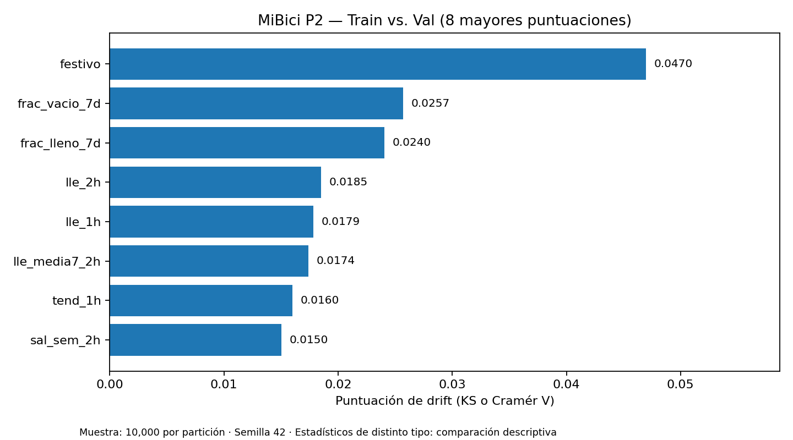
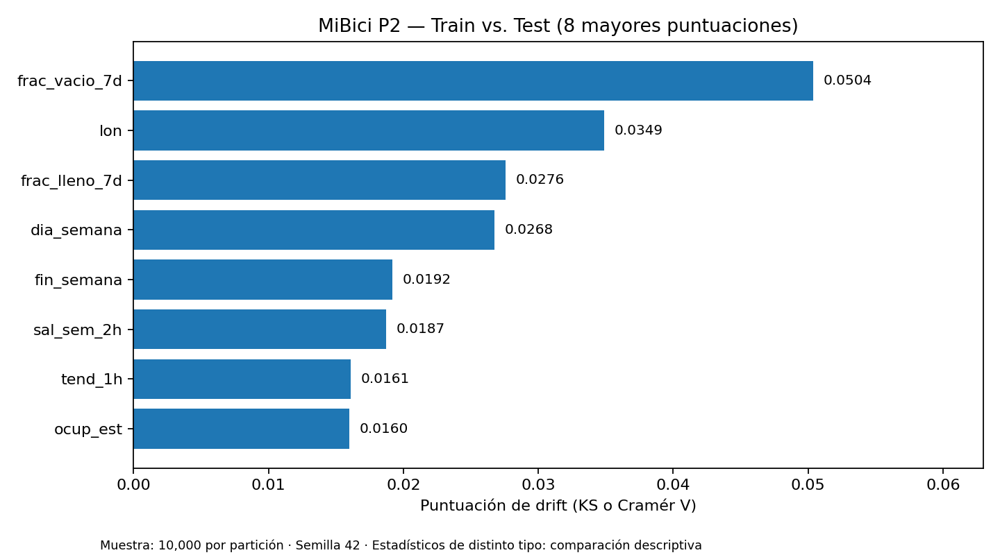

# Análisis de data drift de P2 — MiBici Equipo 37

## Objetivo y alcance

Evaluar cambios en la distribución de las **23 características** utilizadas por P2 (riesgo de vaciado/llenado) entre entrenamiento y validación, y entre entrenamiento y prueba, utilizando `FeatureDrift` de DeepChecks 0.19.1. La tabla se reconstruyó con `python -m MiBici.features p2`, sin volver a entrenar modelos.

## Método y trazabilidad

- Fuente: `data/processed/p2/tabla.parquet`, generada por el pipeline del repositorio.
- Registros: train **3,261,440**; val **568,180**; test **574,500**.
- Muestras: **10,000 registros por partición**, `random_state=42`, sin reemplazo.
- Variables: `features_de_p2()` excluye `estacion`, `dia`, `particion` y `clase`.
- Categóricas declaradas: `hora`, `dia_semana`, `fin_semana`, `festivo`, `riesgo_ayer`; las restantes se analizan como numéricas.
- Estadísticos: Kolmogorov-Smirnov (numéricas) y Cramér's V (categóricas). **No son porcentajes ni equivalentes entre sí**.
- Valores faltantes: se preservan; `ignore_na=True` los excluye de los cálculos de distribución. Sus tasas se revisan por separado.
- No se configuraron condiciones ni umbrales automáticos de alerta; los valores reportados son **descriptivos**, no veredictos de aprobación/rechazo.

## Resultados principales

| Característica | Train vs. Val | Train vs. Test | Método |
|---|---:|---:|---|
| `frac_vacio_7d` | 0.0257 | 0.0504 | KS |
| `frac_lleno_7d` | 0.0240 | 0.0276 | KS |
| `lon` | 0.0148 | 0.0349 | KS |
| `festivo` | 0.0470 | 0.0082 | Cramér's V |
| `dia_semana` | 0.0118 | 0.0268 | Cramér's V |





Las puntuaciones mayores de la comparación con prueba se concentran en `frac_vacio_7d`, `lon` y `frac_lleno_7d`. En validación destaca `festivo`. Son **diferencias observadas en las distribuciones muestrales**, no evidencia suficiente de drift crítico, degradación de desempeño ni causalidad. Las variables geográficas y de calendario requieren interpretación contextual.

### Faltantes y limitaciones

`riesgo_ayer` tiene faltantes en **9.66%** de train, **8.71%** de val y **7.86%** de test. `sal_sem_2h` y `lle_sem_2h` presentan **1.36%** de faltantes en train y ninguno en val/test. Estos cambios de completitud se documentan por separado y no están incluidos en los estadísticos de drift con `ignore_na=True`.

La comparación utiliza muestras reproducibles, no la totalidad de los registros; no incluye pruebas de desempeño del modelo ni umbrales de significancia operativa. Por tanto, se recomienda **monitorear** las características señaladas si P2 se despliega, sin afirmar que el modelo deba reentrenarse con esta sola evidencia.

## Reproducción y archivos

Desde la raíz del repositorio, con el entorno de validación instalado y los datos locales preparados:

```bash
python -m MiBici.features p2
python scripts/validate_drift.py
```

Se genera `reports/deepchecks/drift_p2_resumen.json` y, localmente, los HTML completos `drift_p2_train_vs_val.html` y `drift_p2_train_vs_test.html`. Estos HTML (~111 MB cada uno) se conservan **fuera de Git** para evitar añadir más de 220 MB al repositorio; las figuras PNG y el JSON resumen son la evidencia versionada. No se publican registros individuales.

**Fuente:** resultados generados por DeepChecks a partir de la tabla reconstruida de P2, 1 de noviembre de 2026.
