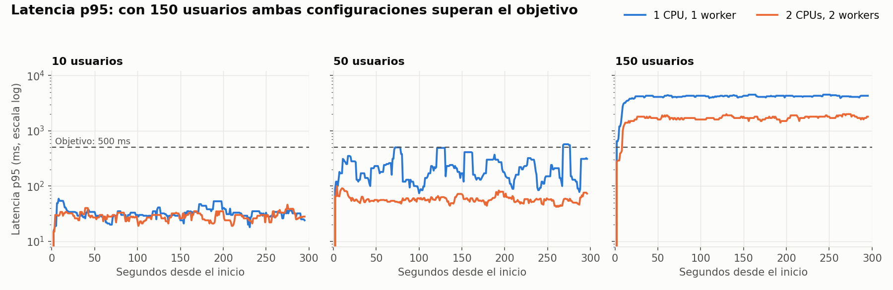
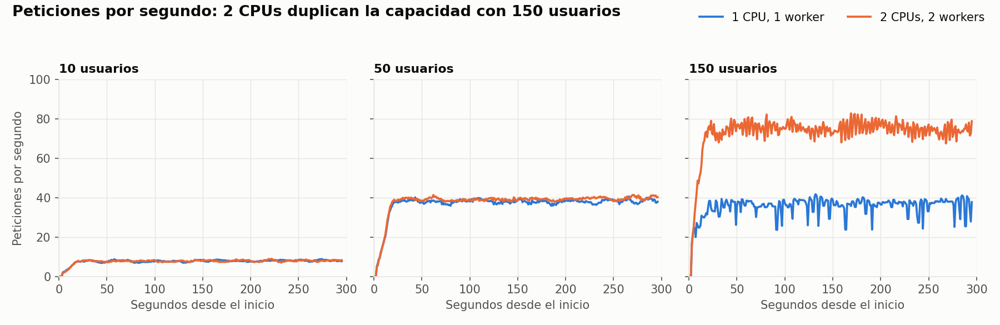
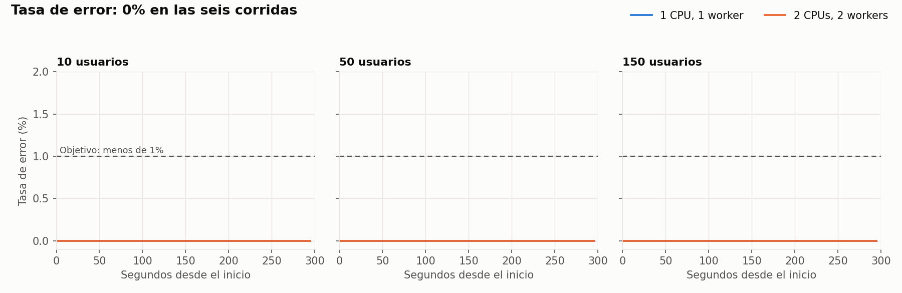
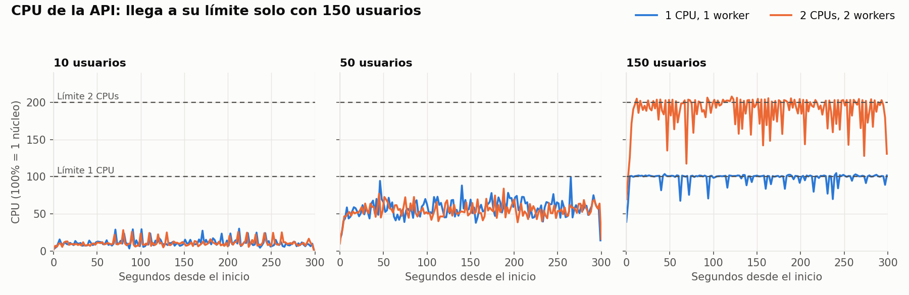
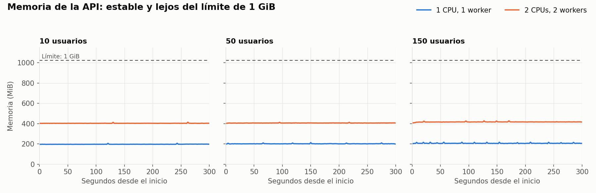

# Pruebas de carga y monitoreo de recursos

**Conclusión: la API atiende 50 usuarios (unas 38 peticiones por segundo) dentro del objetivo con 1 CPU, y no soporta 150 usuarios con ninguna de las dos configuraciones probadas.** Pasar de 1 a 2 CPUs duplica la capacidad máxima, de 35 a 75 peticiones por segundo. El recurso que limita el servicio es el CPU; la memoria se mantiene por debajo de 45% de su límite.

## Escenario

Se probó `POST /predict_p2/`, el endpoint de predicción de riesgo de vaciado o llenado (P2), con [Locust](../../tests/load/locustfile.py).

- **Usuarios simulados:** cada uno envía una estación con valores aleatorios válidos y espera entre 0.5 y 2 segundos antes de la siguiente petición.
- **Niveles de carga:** 10, 50 y 150 usuarios, que equivalen a unas 8, 40 y 120 peticiones por segundo solicitadas. Cada corrida dura 5 minutos e incluye una rampa de 10 segundos.
- **Qué cuenta como error:** una respuesta distinta de 200, una predicción fuera de las clases 0, 1 o 2, o una respuesta que tarda más de 8 segundos.
- **Objetivo de servicio:** latencia p95 menor a 500 ms y menos de 1% de errores.
- **Configuraciones:** 1 CPU con 1 worker de Uvicorn, y 2 CPUs con 2 workers. Ambas tienen 1 GiB de memoria y `OMP_NUM_THREADS=1`.
- **Monitoreo:** `docker stats` registró CPU y memoria de los contenedores cada 2 segundos durante cada corrida.

## Resultados

| Configuración | Usuarios | Peticiones/s | p50 | p95 | p99 | Errores | CPU promedio | Memoria máx. | Cumple objetivo |
|---|---:|---:|---:|---:|---:|---:|---:|---:|---|
| 1 CPU, 1 worker | 10 | 7.8 | 14 ms | 32 ms | 47 ms | 0% | 11% | 206 MiB | Sí |
| 1 CPU, 1 worker | 50 | 37.6 | 31 ms | 210 ms | 440 ms | 0% | 57% | 213 MiB | Sí |
| 1 CPU, 1 worker | 150 | 35.3 | 3,600 ms | 4,300 ms | 4,500 ms | 0% | 98% | 217 MiB | **No** |
| 2 CPUs, 2 workers | 10 | 7.8 | 13 ms | 29 ms | 40 ms | 0% | 11% | 414 MiB | Sí |
| 2 CPUs, 2 workers | 50 | 38.9 | 14 ms | 59 ms | 90 ms | 0% | 54% | 413 MiB | Sí |
| 2 CPUs, 2 workers | 150 | 74.6 | 670 ms | 1,700 ms | 2,000 ms | 0% | 188% | 428 MiB | **No** |

En el CPU, 100% equivale a un núcleo completo. Los valores completos están en [`resumen.csv`](resumen.csv).

### Latencia



Con 10 usuarios ambas configuraciones responden igual de rápido. Con 50, las dos cumplen, pero la de 1 CPU es menos estable: su p95 global es 3.6 veces mayor y tiene picos cercanos a 500 ms. Con 150, la API recibe más peticiones de las que procesa, se forma una cola y la latencia supera el objetivo.

### Peticiones por segundo



Hasta 50 usuarios, el servicio procesa lo que recibe. Con 150 se ve la capacidad real de cada configuración: unas 35 peticiones por segundo con 1 CPU y unas 75 con 2 CPUs.

### Tasa de error



No hubo errores en las 60,436 peticiones. Este resultado debe leerse junto con la latencia: con 150 usuarios el servicio no falla, pero responde demasiado lento para cumplir el objetivo.

### CPU



Con 150 usuarios, la API llega al límite de CPU en ambas configuraciones, y ese es el punto en que la latencia se dispara. El contenedor de MLflow se mantuvo por debajo de 1% de CPU promedio, porque el modelo va empacado en la imagen de la API.

### Memoria



La memoria se mantiene estable durante cada corrida, sin señales de fuga en estos 5 minutos. Cada worker ocupa unos 200 MiB porque carga su propia copia del modelo.

## Recomendaciones

1. **Para cargas de hasta 50 usuarios, usar 2 CPUs y 2 workers.** Una sola CPU cumple el objetivo, pero con menos margen ante picos.
2. **Para 150 usuarios, escalar a unas 4 CPUs y 4 workers, con 2 GiB de memoria.** Es una proyección a partir de unas 37 peticiones por segundo por CPU y 200 MiB por worker, y debe confirmarse con una prueba.
3. **Definir un límite de concurrencia o una respuesta 503 ante saturación.** Hoy las peticiones se acumulan en cola en lugar de rechazarse, por lo que la latencia crece sin generar errores.

## Limitaciones

- Se hizo una corrida por combinación, así que no se mide la variación entre repeticiones.
- Locust y la API corrieron en la misma máquina, por lo que los resultados no representan un despliegue en producción.
- Solo se probaron tres niveles de carga. El punto exacto en que se deja de cumplir el objetivo está entre 50 y 150 usuarios.
- Las corridas duran 5 minutos, insuficiente para detectar degradación o fugas de memoria a largo plazo.

## Cómo reproducir

```bash
python3 -m venv ~/.venvs/locust
~/.venvs/locust/bin/pip install -r requirements-load.txt
source ~/.venvs/locust/bin/activate

# 1 CPU y 1 worker
API_CPUS=1 UVICORN_WORKERS=1 docker compose up -d --build --force-recreate --wait
make loadtest LOAD_USERS=10 LOAD_OUT=reports/load_test/1cpu_1w
make loadtest LOAD_USERS=50 LOAD_OUT=reports/load_test/1cpu_1w
make loadtest LOAD_USERS=150 LOAD_OUT=reports/load_test/1cpu_1w

# 2 CPUs y 2 workers
API_CPUS=2 UVICORN_WORKERS=2 docker compose up -d --force-recreate --wait api
make loadtest LOAD_USERS=10 LOAD_OUT=reports/load_test/2cpu_2w
make loadtest LOAD_USERS=50 LOAD_OUT=reports/load_test/2cpu_2w
make loadtest LOAD_USERS=150 LOAD_OUT=reports/load_test/2cpu_2w
```

Cada corrida genera un reporte HTML de Locust, los CSV de métricas y el registro de `docker stats`. Los reportes de esta prueba están en [`1cpu_1w/`](1cpu_1w/) y [`2cpu_2w/`](2cpu_2w/).
